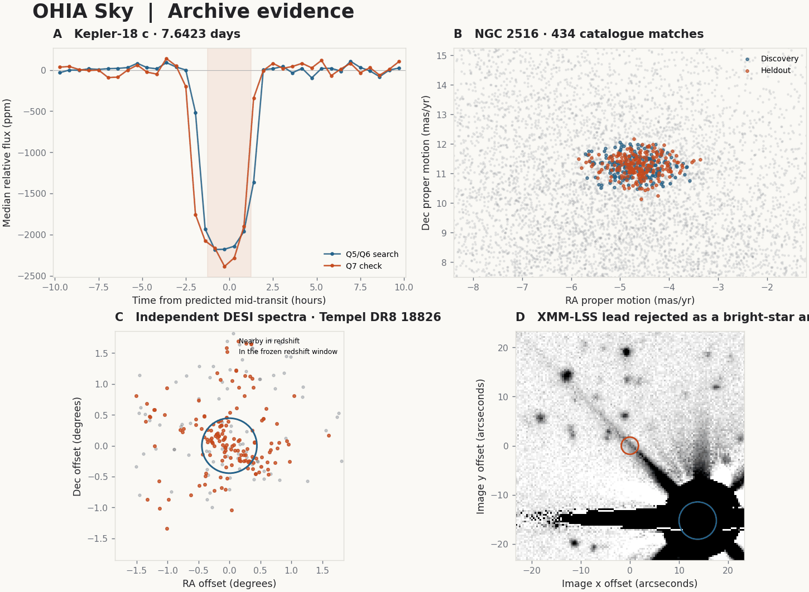

# OHIA Sky

## Checks on astronomical signals in public archives

**Primitive AI Labs · Research note v0.1 · 19 November 2026 (Perth)**

OHIA Sky proposes an astronomical signal from one part of the data, freezes what the signal predicts, and evaluates that prediction on a second part. We applied this procedure to Kepler stellar brightness, Gaia stellar motions, Legacy Survey images and Sloan galaxy redshifts. Two small models learned to rank transit and image candidates. The experiment recovered **56 confirmed planet signals around 41 stars**, found at least two planets around **12 of those stars**, and identified **775 Gaia sources** whose stellar group membership matched a published catalogue. Two previously catalogued galaxy concentrations were recovered in Sloan and supported by independent DESI spectra. A broader catalogue check matched the last apparent galaxy-group outlier. A separate image lead was rejected as a bright-star artifact. This study establishes zero previously unknown astronomical objects.



**Figure.** A shows binned Kepler-18 c phases in the search quarters and the fixed prediction in the check quarter. B shows proper motions of selected Gaia sources for NGC 2516 against surrounding sources. C shows independent DESI spectra near Tempel DR8 group 18826. The circle is the aperture fixed using Sloan. D shows the median of the three Legacy Survey bands. The orange circle marks the rejected pixel peak and the blue circle marks the bright star.

## Results

| Search | Inputs and measured result |
| --- | --- |
| Planets | 167 Kepler targets searched with enough data in all three quarters, from 198 selected. Of 1,384 proposed periods and phases, 56 distinct confirmed planets and six already-listed Kepler candidates were recovered at the fixed repeatability gate. |
| Planetary systems | 12 stars had at least two distinct confirmed planet signals recovered. Kepler-18, Kepler-114 and Kepler-416 each had three. Searches after masking an earlier signal recovered 13 of the 56 planets. |
| Stellar groups | 203,986 Gaia DR3 sources across six fields. Six groups passed held-out density checks. Of 790 flagged Gaia sources, 775 exactly matched source IDs in the published group member lists. The match was 392 of 398 on the held-out half. |
| Galaxy images | 3,262 pixel peaks across six cutouts. 2,426 unique peaks matched distinct extended-profile catalogue entries. The trained ranker and z-band check called 765 of those matches extended. The catalogue label records morphology. |
| Galaxy concentrations | 38,758 Sloan spectroscopic galaxy rows across three partially overlapping fields. 41 candidate windows passed the held-out screen, 40 of which matched at least one of the Abell, Tempel DR8 or Tempel DR12 lists. Several windows sample the same structure. The matches include 11 distinct Abell clusters. |

## Search and verification

### Transits

The search used MAST long-cadence PDCSAP flux, retaining finite cadences with zero quality flags. Each uninterrupted light-curve segment was divided by a 71-cadence running median. The search used Kepler quarters 5 and 6. Box least squares searched periods of 0.82 to 20 days using five trial durations between 0.0613 and 0.3269 days. The trial frequency step was the shortest duration divided by twice the search time span. Up to five peaks were refined locally, and up to two additional searches used flux with the strongest earlier dips masked at their predicted times.

A proposal fixed a period, a reference mid-transit time and a duration. At each predicted event, OHIA compared median flux inside the dip with adjacent baseline flux and estimated uncertainty from local scatter. The unchanged ephemeris then predicted a sequence of dips in quarter 7. The repeatability screen required at least three usable quarter-7 events, a positive dip in at least 65% of them, quarter-7 event SNR of at least four and supporting evidence in both discovery quarters. Off-phase boxes, odd/even depth differences and a secondary eclipse at half phase checked alternative explanations. The control-phase rank is descriptive because nearby boxes can share data.

Target selection used known dispositions to enrich the validation sample. Search periods and epochs came from the light curves. A candidate counted as a confirmed recovery only when its period and phase matched the catalogue directly and its predicted dips passed the repeatability screen. The recovered count includes these gated signals from all splits. Model training and calibration used disjoint hosts and excluded the evaluation and application hosts. The 14-feature selector learned from 72 catalogue-matched signals on 55 hosts. Its threshold was set using 19 signals on 16 separate hosts. All percentages below are from 22 matched signals on a further 16 hosts, of which 16 were confirmed planets and six were catalogue false positives or binaries.

| Transit decision rule on the same evaluation signals | Planet calls | False calls | Recall |
| --- | ---: | ---: | ---: |
| Fixed repeatability and eclipse checks | 14 | 2 | 87.5% |
| Same checks with the minimum split-quarter SNR ranker | 5 | 1 | 31.3% |
| Same checks with the trained OHIA ranker | 12 | 0 | 75.0% |

The learned ranker traded two recovered planets for two fewer false calls relative to the fixed checks. Its ROC AUC on this selected sample was 0.979. On 36 injections made into 12 real, unlabelled light curves using fixed trapezoidal signals, the period and phase were recovered and passed the repeatability check in 35 cases. The model accepted 11 of 12 injections at 250 ppm, 10 of 12 at 600 ppm and nine of 12 at 1,200 ppm. On these examples the policy occasionally rejected a strong artificial transit. These small tests do not measure survey completeness or the prevalence of real planets among future calls.

### Stars, galaxies and structure

The stellar search split each Gaia field by source rows before fitting local density in angular position, parallax and two components of proper motion. The aperture and kinematic ellipse fixed on the first half were evaluated on the second half. A shuffled-overlap control preserved sky and kinematics as intact blocks. Sources in the accepted windows were checked by Gaia DR3 ID against Hunt and Reffert. The reference catalogue and this pass use Gaia observations in common.

The imaging detector located peaks at two spatial scales using g and r pixels and required usable flux with positional agreement in z. It learned a 15-feature extended-morphology ranker using Legacy Survey Tractor profiles as labels. Three image fields trained the ranker, one calibrated it and two were reserved for testing. In the two test fields, OHIA correctly called 156 extended-profile objects and incorrectly called 12 catalogue point sources extended, for 92.9% precision and 48.6% recall. A calibrated r-band half-light-radius rule attained 89.3% precision and 54.8% recall. The profiles were inferred from the same survey, and spectroscopy would address physical classification.

The group search used Sloan `SpecObj` primary spectra classified as galaxies with `zWarning=0`. A split-row density pass fixed angular and redshift windows. The held-out half tested enrichment relative to shuffling redshift and sky position within each field. The resulting windows describe concentrations in redshift space, where radial velocities and survey targeting can affect shape. Catalogue matches were made after selection. Five candidate windows were then checked in DESI DR1 main bright-program Redrock spectra, using the Sloan aperture and redshift window without changing either. Each comparison used an annulus and a shared parent redshift interval of ±0.02, with an exact one-sided Fisher test and a five-window Bonferroni correction.

| Spectroscopic confirmation of already-known concentrations | DESI galaxies in redshift window inside aperture | DESI galaxies in window in comparison annulus | Adjusted p |
| --- | ---: | ---: | ---: |
| Tempel DR8 18826, also USGC U418 in NED | 70/90 | 62/124 | 0.000131 |
| Tempel DR8 29348 | 56/98 | 150/1,186 | 5.53 × 10⁻²² |

Of the in-window DESI spectra, 25 and 36 respectively had no counterpart within two arcseconds in the Sloan tables used here. That comparison concerns the exact Sloan input subset. DESI bright-program coverage was incomplete in other sampled apertures, including the Coma control.

## Leads and disposition

| Record | Position or period | Evidence and status |
| --- | --- | --- |
| `LS10-xmm_lss-0395` | RA 34.556484°, Dec −4.967423° | Rejected as a bright-star artifact. The peak repeated in g/r/z and had no close Tractor or NED match. Wider inspection placed it on a diagonal spike from a saturated star 20.56 arcseconds away. Flux along that direction exceeded the flanks on both sides of the peak in all three bands. |
| `SDSS-coma_leo-03-00` | RA 178.205600°, Dec +20.625473°, z 0.022531 | The fixed window included 16 held-out Sloan galaxies and missed the three initial group lists. NED returned `[ETK2025] J115242.6+203753` at a separation of 0.027° and a redshift difference of 0.000331, plus other entries near the same position and redshift. The saved DESI bright-program sample had zero eligible galaxies in this aperture. |
| `KIC 7983756` | 5.240659 days | A repeatable signal recovered after masking. It matches NASA Kepler DR25 threshold-crossing event `7983756.02`. Its host was in the stellar false-positive cohort. The event remains a catalogue follow-up item. |
| 42 quiet-control Kepler targets | 0.82–20 days | Zero unlisted periodic dips passed the complete vetting gate. The targets were selected using coverage and noise criteria and excluded hosts with a listed KOI or DR25 threshold crossing. |

## Inspect the evidence

[Evidence receipts](evidence.json) include sample counts, individual recovered planet periods, stellar membership crossmatches, selected data URLs and independent spectroscopic checks. [The verifier](verify.py) recomputes the receipt totals and the exact DESI tests from their contingency counts using the Python standard library.

```sh
python3 verify.py
```

This verifies the published receipts. Repeating the raw-data search requires acquiring the named inputs and implementing the search and verification protocol above. The fitted rankers and pipeline were evaluated on this run. The order of operations, tolerances and quality cuts are study choices, and the resulting estimates apply to the listed samples.

## References and data access

- Kepler mission long-cadence light curves and processing products. [MAST](https://archive.stsci.edu/missions-and-data/kepler) · [Open-data mirror](https://registry.opendata.aws/mast-kepler/)
- Kepler Objects of Interest and threshold-crossing events. [NASA Exoplanet Archive KOIs](https://exoplanetarchive.ipac.caltech.edu/docs/Kepler_KOI_docs.html) · [Kepler DR25 TCEs](https://www.ipac.caltech.edu/doi/10.26133/NEA15)
- Kirk et al. (2016), Kepler Eclipsing Binary Catalogue. [VizieR J/AJ/151/68](https://vizier.cfa.harvard.edu/viz-bin/VizieR?-source=J%2FAJ%2F151%2F68)
- Gaia Collaboration and DPAC, Gaia Data Release 3. [ESA archive documentation](https://gea.esac.esa.int/archive/documentation/GDR3/)
- Hunt and Reffert (2024), open cluster census and membership. [DOI 10.1051/0004-6361/202348662](https://doi.org/10.1051/0004-6361/202348662)
- SDSS DR18 spectroscopic access and primary spectrum view. [Data access](https://www.sdss.org/dr18/data_access/get_data/)
- Legacy Survey DR10 imaging and Tractor catalogue. [Data release](https://www.legacysurvey.org/dr10/description/) · [Profile definitions](https://www.legacysurvey.org/dr10/catalogs/)
- Struble and Rood Abell redshifts, and Tempel et al. SDSS groups. [Abell redshifts](https://heasarc.gsfc.nasa.gov/W3Browse/galaxy-catalog/abellzcat.html) · [Tempel DR8](https://doi.org/10.1051/0004-6361/201118687) · [Tempel DR12](https://doi.org/10.1051/0004-6361/201730499)
- DESI DR1 Redrock spectroscopy and NASA/IPAC extragalactic catalogue. [DESI release](https://data.desi.lbl.gov/doc/releases/dr1/) · [NED query interface](https://vo.ned.ipac.caltech.edu/Documents/Guides/Interface/TAP)

## Follow-up

[Round 3 Kepler campaign and Lean proofs](round-3/README.md).
